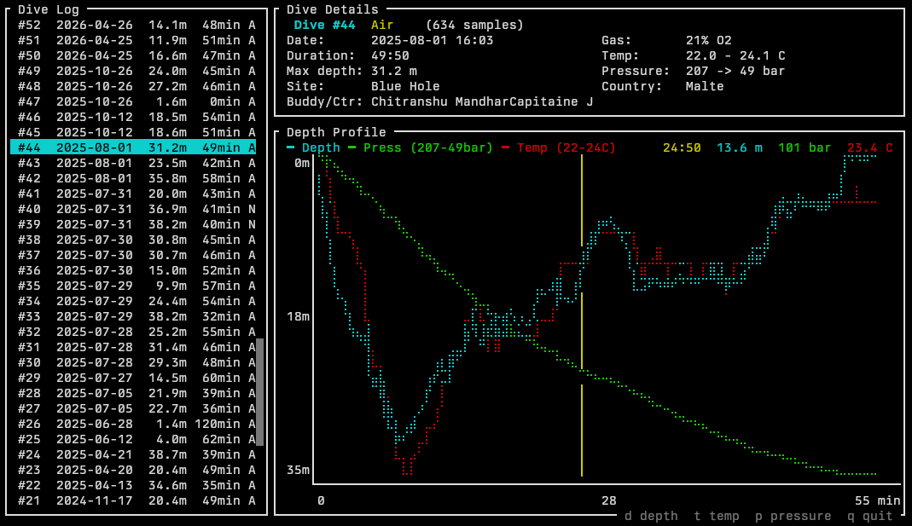

# dive-rs

Rust CLI tool that extracts dive logs from dive computers via Bluetooth Low Energy (BLE). It currently supports the Mares GENIUS family, tested with the Sirius, and reverse-engineers the proprietary ECOP protocol (CANopen SDO over BLE) used by Mares GENIUS-family devices.



## Features

- **Scan** for nearby Mares BLE devices
- **Download** dive logs over BLE (incremental — skips already-downloaded dives)
- **Parse** previously saved raw binary data offline
- **Correlate** with SSI dive log CSV exports to import dive site, country, and buddy info
- **View** dive logs in an interactive TUI with depth/temperature/pressure charts
- **Export** dives as FIT activities, for apps that overlay Garmin Descent dive data on video

## Supported Devices

Any Mares GENIUS-family dive computer should work, including:

Sirius, Genius, Quad, Quad Air, Quad Ci, Quad2, Horizon, Smart Air, Puck Pro, Puck 2, Puck 4, Puck Air 2, Nemo Wide 2, Icon HD, Icon AIR

Tested with the **Mares Sirius**.

## Requirements

- Linux with BlueZ (BLE stack)
- Rust toolchain

## Build

```bash
cd dive-rs
cargo build --release
```

## Usage

### Scan for devices

```bash
dive-rs scan
dive-rs scan --enumerate   # also list GATT services
```

### Download dive logs

```bash
dive-rs download                          # saves to dives.json
dive-rs download -o my_dives.json         # custom output path
dive-rs download --save-raw raw_data/     # also save raw binary data
```

Re-running `download` is incremental — only new dives are fetched.

### Parse raw data offline

```bash
dive-rs parse --raw-dir raw_data/
```

### Correlate with SSI export

Import dive site, country, and buddy information from an SSI dive log CSV export:

```bash
dive-rs correlate
dive-rs correlate --ssi "my.DiveSSI.com - mydivelog.csv" --json dives.json
```

Dives are matched by exact date and time (minute-level).

An SSI entry with no dive at its minute is a dive the watch never handed over: it is imported as a dive of its own, with the date, duration, depth, site and buddy of the logbook, and no profile. An entry that overlaps a dive of the watch is taken for that dive under another start time and left out.

The SSI export glues the buddies of a dive to one another. They are told apart from the rest of the logbook, where each shows on its own or next to others, and written with commas between them, the dive center last.

### Interactive viewer

```bash
dive-rs view
```

Navigate with `j`/`k` or arrow keys. Toggle overlays with `d` (depth), `t` (temperature), `p` (pressure). Quit with `q`.

Dives are listed by date and numbered as the SSI logbook numbers them: in that order, scuba dives and freedive sessions each on their own, ignored dives not counted. The number a dive has on the watch shows next to its title. `fit` names dives by the same logbook number. In the list the number is yellow, or cyan for a freedive session.

Press `s` for a page of statistics over the whole logbook: totals and records, dives per year and per month of the year with a colour per country, time under water, depths, and the air used per minute at the surface month after month. That last figure, also shown with each dive, is the gas gone from the tank over the dive time and the mean pressure; it needs a transmitter and is only as right as the tank size the watch was given.

Press `i` to ignore the selected dive, an accidental one for instance. It leaves the list but stays in `dives.json`, marked as ignored, so the next download does not bring it back. `a` lists the ignored dives again, and `i` on one of them takes it back. The `fit` and `correlate` commands leave ignored dives out.

### Export to FIT

Write each dive as a FIT activity file laid out like a dive from a Garmin Descent (sport `diving`, depth in the records, tank pressure as `tank_update` messages, a `dive_summary`). The Insta360 app can import such files for its stats dashboard. What else the watch logs goes in where FIT has a place for it: no-deco time, deco stops, ascent rate, gas time and consumption in the records; gradient factors and water type as `dive_settings`; CNS, OTU and surface interval in the summary; alarms and gas switches as events.

```bash
dive-rs fit                               # every dive of dives.json, into fit/
dive-rs fit -d 2026-10-05                 # the dives of one day
dive-rs fit -n 143 --utc-offset +03:00 --offset 20
```

FIT timestamps are in UTC, while the dive log is in the local time of the dive computer. Its clock is taken to be on the time of the country of the dive, as `correlate` fills it in (France, Malta, Egypt, Croatia, Spain and India are known so far), or on the time of this machine for a dive with no country. `--utc-offset` gives another time zone for a run. To set one for a dive for good, add `"utc_offset": "+03:00"` to it in `dives.json`: it overrules the country. `--offset` adds seconds to the start time, which the log only keeps to the minute.

The profile is interpolated to one record per second, as a Descent logs it; `--interval 0` writes the samples as logged. The files name a Garmin Descent Mk3i as their source.

## Protocol

Key points of the Mares ECOP protocol:

- Communication happens over two GATT characteristics (write + notify) on a custom BLE service
- Commands use 2-byte headers `[cmd, cmd ^ 0xA5]`, responses are framed with `ACK (0xAA)` ... `END (0xEA)`
- Dive data is read via CANopen SDO segmented transfers
- Dive headers are 200 bytes at SDO index `0x3000+i` sub 4
- Profile data uses tagged records: `DSTR`, `TISS`, `DPRS`, `AIRS`, `DEND`
- Depth/temperature samples are at 5-second intervals in `DPRS` records

## License

MIT — see [LICENSE](LICENSE).

This project is not affiliated with Mares. Protocol details were reverse-engineered for personal use.
